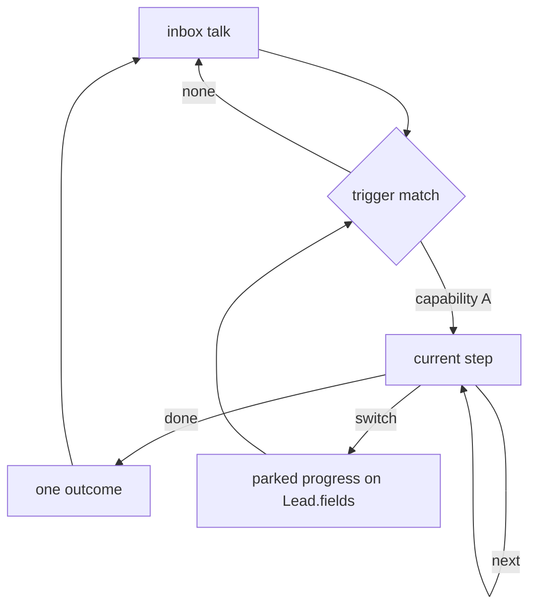

# Custom capability: a steps engine

## What this is

A custom capability is data on a `CapabilityInstance`: an ordered list of steps, a trigger, and one outcome. The inbox talk stage stays the home. The agent enters a capability when its trigger matches, walks the steps, and can leave for another enabled capability on any lead message.

Booking and reservations stay code packs. They are enterable the same way (trigger in, switch out). A custom capability does not reimplement hours checks, slot reconcile, or Request creation. Those outcomes call the handlers that already exist.

This is a closed vocabulary. A new customer sequence is a new document. A new kind of side effect (charge a card, write to a calendar API) is still code.



## Trigger: when it starts

Each capability has:

- `stance`: `primary` or `on_demand`
- `trigger`: a short description plus a few example phrases, in the owner’s language

On every lead message, before the current step advances, a classifier chooses one enabled capability or “stay”. The choice is limited to enabled instance ids. Low confidence stays put.

Landing rules:

- A greeting or a vague ask (“היי”, “אפשר עזרה”) enters the `primary` capability when one is set. Otherwise it stays in the inbox and just answers.
- A message that clearly matches another capability’s examples enters that one, even if a primary exists. The specific trigger wins over the default.
- At most one capability is primary. Turning a second one primary clears the first.
- Only one capability is active in a thread. Starting another parks the current one.

Side questions do not count as a switch. While a step is open, a knowledge question is answered from the tenant’s knowledge, then the agent returns to the open question of the same step.

## Exit: always able to leave

Every step has the same exits, whether the capability is a code pack or a steps document:

- `next` — the step’s own completion (fields filled, link sent, file received)
- `switch` — another enabled capability’s trigger matched
- `inbox` — the lead dropped the process and went back to a general question, or asked to stop
- `escalate` — hand off to a person, with what was already collected

Switching saves progress. Collected fields stay on `Lead.fields`. The session stores `{ instanceId, stepIndex }` for the parked capability. Coming back resumes that step.

A switch during a confirm step still happens. The agent does not block the lead inside a flow. The next time that capability resumes, it re-confirms rather than submitting from a stale yes.

Code packs grow the same exit first: from booking or reservations, a matching trigger for another enabled capability parks the visit/stay collect and enters the other one. That slice does not require the steps runner.

## Steps: what it does along the way

Steps run in order. No branches inside a custom capability. A branch is a second capability with its own trigger, reached through `switch`.

| Step | What the agent does | Config |
|---|---|---|
| `collect` | Asks for a list of fields, one at a time, using the existing field kit (`text`, `date`, `date_range`, `datetime_text`, `enum`, `number`, `phone`, `email`) | `fields: FieldSpec[]` |
| `say` | Sends a specific message at this point (instructions, price range, what happens next) | `text` plus a wording mode |
| `send_link` | Renders a template and sends it. Same shape as reservations `bookingLinkTemplate` | template with tokens such as `{{bookingUrl}}` |
| `collect_file` | Asks for an image or PDF, stores the reference, confirms it was received | accepted kinds |
| `outcome` | Runs the capability’s single end result, then returns to the inbox | one outcome id |

`collect_file` is the one action that does not exist yet. Inbound media is not a stored lead document today. It is a new kernel action, built once, then available to every custom capability. Until it exists, a custom capability cannot honestly claim “we received the document.”

Adding a field edits the `collect` list. It does not rebuild the other steps.

## Wording: persona always, exact text only when asked

Every customer-facing line is wrapped in the current persona (name, gender, tone, length, formality). Three modes, default is the first:

- `persona` — the owner writes a hint (“ask for check-in and check-out”). The model writes the line the way the agent sounds. This is the default for `collect`.
- `humanized` — the owner writes the message they roughly want. The model may adjust voice (gender, length, warmth) and must keep the facts, the link, and any numbers. Use this when the text should stay close to a script.
- `exact` — send the owner’s string as written. Available on `say` and on outcome copy. Not available on `collect`, so a questionnaire cannot bypass the agent’s voice.

A `multi` tenant stores `he` and `en` for `humanized` and `exact`. A missing language falls back to `persona` for that turn rather than sending the wrong language. (what about the conversation replyLanguage field?)

## Outcome: what is left when it finishes

One outcome per capability. The step list can send a link or collect a file in the middle; the outcome is the durable result.

| Outcome | What gets stored | Already in the product |
|---|---|---|
| `create_task` | A `Request` plus a `request_approval` task. Nouns and kind come from the instance. This is the default. | Yes |
| `send_link` | The rendered link is sent. No Request, no waiting-on-human. | Yes, reservations `submitMode: "send_link"` |
| `handoff` | A human task with the collected fields and the reason | Yes, `request_human` |
| `confirm_received` | The file reference is stored and the lead is told it arrived. Optional owner task so it shows in the CRM | No — depends on `collect_file` |

After the outcome, `flowState` returns to the inbox. The parked capability is cleared. A later message can start it again from step 0; stored lead fields still count, so the agent does not re-ask a name it already has.

## What the owner edits

```ts
type CustomCapability = {
  stance: "primary" | "on_demand";
  trigger: { description: string; examples: string[] };
  steps: Array<
    | { type: "collect"; fields: FieldSpec[]; wording?: "persona" | "humanized"; text?: Localized }
    | { type: "say"; wording: "persona" | "humanized" | "exact"; text: Localized }
    | { type: "send_link"; template: Localized }
    | { type: "collect_file"; accept: Array<"image" | "pdf">; wording?: "persona" | "humanized"; text?: Localized }
    | { type: "outcome"; outcome: "create_task" | "send_link" | "handoff" | "confirm_received"; wording?: Wording; text?: Localized }
  >;
};
```

`Localized` is `{ he?: string; en?: string }`. Validation rejects an unknown step type, a `collect` with no fields, a `send_link` or `exact` say with no text, two outcomes, and `confirm_received` while `collect_file` is missing from the product. The same validator runs on a hand-written document and on a model draft.

## Authoring from free text

The owner describes the process in plain language (“כשמבקשים הצעת מחיר, תשאל מה האירוע ומתי, תשלח את הלינק למחירון, ותפתח לי משימה”). The model returns a `CustomCapability` through a schema, the same pattern as [`extractOnboardDetails`](src/lib/flow/onboard-extract.ts).

The draft is not live until the owner saves. The review screen shows the steps in order, the trigger examples, the outcome, and one sample thread (no DB write, same idea as the persona preview). Saving writes a `CapabilityInstance` and an `AgentConfigRevision`.

A later change is a patch, not a fresh document. “תוסיף גם מספר מוזמנים” adds a field on the existing `collect` step. “בסוף תשלח לינק במקום משימה” changes the outcome. The model proposes the diff; the owner confirms. A description that needs a step type outside the table is refused with the closest supported shape, and the owner sees that a piece was left out.

The model never emits interpreter code, tools, or a new outcome id.

(we should create this agent prompt/skill after we've agreed on the implementation details of the solution)

## What stays code

- The step runner, the switch classifier, and the validator
- Field asking, normalization, and persona wrapping
- Outcome handlers: create task, send link, handoff, and later confirm-received
- Booking and reservations, until a steps document can express their reconcile rules without losing them

## Order of work

1. Switch exit on the capabilities that already exist, so a lead can move between visit and stay (or a future custom one) without finishing the first. Park fields. Resume on return.
2. Steps runner for `collect`, `say`, `send_link`, and outcomes `create_task`, `send_link`, and `handoff`. Wording modes included. This is enough for a customer whose script is “ask these things, say this, open a task or send a link.”
3. Free-text draft, diff edits, and a sample-thread preview.
4. `collect_file` and `confirm_received` when a customer actually needs a document received and acknowledged.

Tomorrow’s customer uses (1) only if they need to move between two existing capabilities, and (2) only if their script is not a visit or a stay. Building (3) and (4) is not required to support that customer, and it is the part that can wait without a later data migration: a steps document is a new instance config, and old booking rows stay as they are.

(consider also that being able to create an existing capability as a custom capability is a suceess metric)