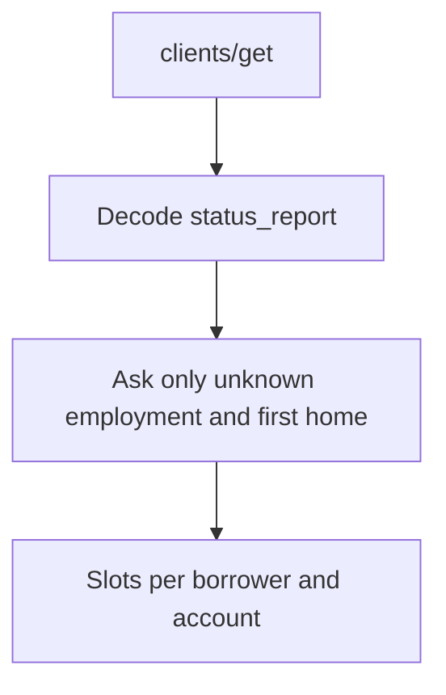

# Checklist from employment codes, then questions

Snir's two lists fall out of each borrower's employment. There is still no workflow id.

- Salaried (`status_report` `1`): identity, three payslips, a statement per known account, loans when loans are known.
- Self-employed (the string `"0"`): identity, 2025 tax assessment, the 2026 accountant form, statements, loans when known.
- One of each: both of the above, each on that borrower.

A person who is both salaried and self-employed is outside those two lists. Flag the advisor and do not invent their file list. Public sector (`2`) and controlling shareholder (`3`) use the salaried list until Lior says otherwise. First-home stays a question; `transaction_type` does not answer it.

## Employment codes

[mapSmartProfile](src/lib/documents/smart-npv.ts) looks for `employment`, `employmentType`, and `employment_type`. The client payload has none of those, so employment is always `""`. [mortgage-rules.ts](src/lib/documents/mortgage-rules.ts) only adds income documents when employment is `employed` or `self_employed`, so a real client is never asked for payslips. That is the bug to fix.

The code table is a third-party copy of the logged-in guide, [snpv_lookups.md](https://github.com/haiku-code/cia-knowledge/blob/main/poc1/reference/snpv_lookups.md), tab מעמד תעסוקתי, field `status_report`. The same page is `https://www.snpv.co.il/api/v2/guide/clients` for a logged-in user. Our live slice fits it: borrower 1 had `2` on 16 clients, `1` on 2, `5` on 2, and empty on 10.

| Code | Label | What we do |
|---|---|---|
| 1 | שכיר/ה | Salaried list. |
| 2 | מגזר ציבורי | Salaried list, until Lior says otherwise. |
| 3 | שכיר/ה בעל שליטה | Salaried list, until Lior says otherwise. |
| 0 | עצמאי/ת | Self-employed list, only when the value is the string `"0"`. |
| 5 | שכיר ועצמאי | Flag the advisor. |
| 4, 6, 7, 8, 9 | לא מועסק/ת, מלגה, קצבה, פנסיונר/ית, אישור מוסד תורני | Ask the client. |
| empty | | Ask the client. Do not treat empty as code 0. |

The lookup file says the API sends code `0` as an empty string for `transaction_type` only (מחזור). It does not say that about `status_report`. Empty employment stays unknown until someone opens an empty client in Smart NPV and compares the screen. Lior or Nave can confirm the whole table the same way: guide, קטגוריות, מעמד תעסוקתי, then two or three clients.

Store the raw code and the decoded label per borrower. The customer question, once, names the borrower:

> כדי לבקש רק את המסמכים הרלוונטיים, מה מצב התעסוקה של כל אחד מכם — שכיר/ה, עצמאי/ת או גם וגם?

A customer answer overrides the code for that borrower. Store source `customer` and the time. Identity proceeds while employment is still unknown. Income slots stay closed until the code or the answer opens them.

## First home and loans

`transaction_type` now has labels in that same lookup file (`1` is שיפוצים, `5` is יד שניה, empty may be מחזור). None of those labels means first home. The lookup's `asset_type` `4` is דירה ראשונה, and that field was not in the client payload we read. Keep asking:

> האם המשכנתה מיועדת לרכישת הדירה הראשונה שלכם?

`false`, or a flagged employment code, opens an advisor flag and does not add income or banking slots from these lists.

[hasLoans](src/lib/documents/smart-npv.ts) returns false when `liabilities` is empty, so the loan slot is skipped. Empty means unknown, not none. Ask whether there are loans. Nonempty `liabilities`, or `current_mortgage` above 0, means loans are known and the loan-balances slot opens.

## Generate slots

Document types stay data in [src/lib/documents/mortgage-rules.ts](src/lib/documents/mortgage-rules.ts): `id_card`, `id_appendix`, `payslip`, `tax_assessment`, `accountant_letter`, `bank_statement`, `loan_balances`. Drop `income_confirmation`.

A generator next to `requiredSlots` builds slots from facts. Slot ids include the borrower or the account.

| Fact                                         | Slots                                                                                            |
| -------------------------------------------- | ------------------------------------------------------------------------------------------------ |
| Each confirmed borrower                      | One ID. The Hebrew label says a biometric card also needs the other side. One full appendix.     |
| Employment salaried, including codes 2 and 3 | Three payslips, each dated within 3 months, for that borrower.                                   |
| Employment self-employed                     | Tax assessment for `taxYear`, and the accountant letter for `accountantYear`, for that borrower. |
| Employment both, or first home false         | No income or banking slots from these lists. Open an advisor flag and include the decoded label. |
| Employment unknown or first home unknown     | Ask.                                                                                             |
| Each known account                           | One bank statement covering the last 3 months. Zero `banks_accounts` means unknown, so ask.      |
| Loans known                                  | One loan-balances slot.                                                                          |
| Loans unknown                                | No loan slot until the customer answers.                                                         |

Years stay on the rules document (`taxYear`, `accountantYear`), defaulting to 2025 and 2026.

## Documents already in Smart NPV

Do not close slots from `document_type_id` in this slice. Upload accepts `file_name` and `file` only, so files we send arrive with no category and Lior sees the name. His own files may also live in WhatsApp groups rather than on the client. Matching type numbers does not move the pilot.

Correct [docs/research/smartnpv-final-mapping.md](docs/research/smartnpv-final-mapping.md). Its public-library table is wrong. The site and [smartnpv-document-mappings.json](docs/research/smartnpv-document-mappings.json) say id `67` is בקשה לבקשת הלוואה, not תעודת זהות. Delete that invented table and point at the JSON plus the uploaded pairs we actually saw (`15`, `28`, `31`, `33`, `38`).

Before relying on uncategorized uploads, send one test file with Lior and ask whether a name with no category is enough for his work. That is a check with him, not more mapping research.

## Accountant PDF

Send [docs/אישור רואה חשבון עוסק מורשה.pdf](docs/אישור רואה חשבון עוסק מורשה.pdf) once when a self-employed borrower still owes `accountant_letter`. [sendZernioInboxMessage](src/lib/zernio.ts) is text only today, so the inbox send has to carry the document using the body that API already accepts. The Hebrew and English line says the attached form must be filled and sent back. after sending the file the next user doc upload to whatsapp is assumed to be this doc signed. (can we validate that? if not just accept it and upload). The checklist stays internal.

## Docs and tests

Update [docs/documents.md](docs/documents.md): the decoder, why empty is not self-employed, why `transaction_type` is not first-home, and why uploads have no category.

Tests:

- `status_report_1` `"1"`, one account, known loans: ID, appendix, three payslips, one statement, loans. No tax assessment. No employment question.
- `status_report_1` `""`: no payslips until the customer says salaried.
- `status_report_2` `"0"` with a real second id: tax assessment and accountant letter for borrower 2 only.
- `status_report` `"2"` or `"3"`: the salaried list, same as `"1"`.
- `status_report` `"5"`: advisor flag, no payslips and no accountant letter.
- Empty `liabilities` and no `current_mortgage`: no loan slot until the customer says there are loans.
- A Smart NPV file titled תעודת זהות does not, by itself, close the ID slot.