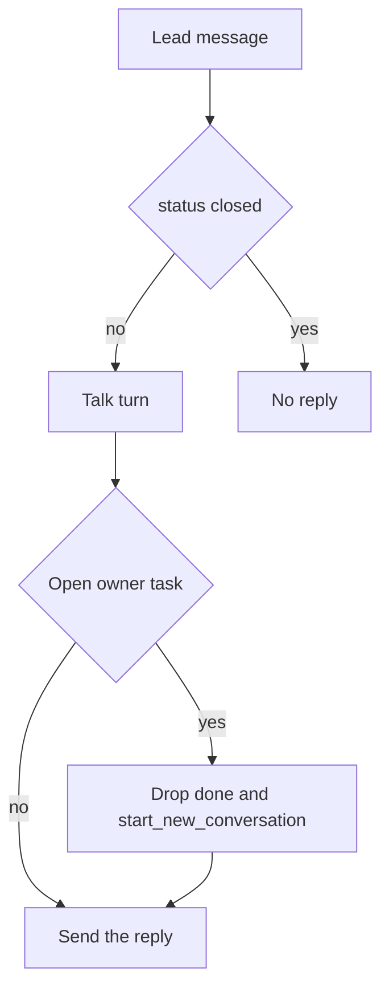

# Keep the owner’s decision, stop muting the thread

Today one status does two jobs. `book_meeting`, `create_reservation_hold`, and `request_human` all set `Conversation.status` and `flowState` to `waiting_human`. The next inbound never reaches talk. [`interpretTurn`](src/lib/flow/interpreter.ts) sends one holding line (`waitingHumanHold`) and returns `skipped: "waiting_human"`.

That mute is the part to drop. The owner still has to decide before the request is confirmed or the thread ends. Everything else on an open thread stays available: knowledge answers, corrections on the still-pending request, and any other enabled capability.

The booking prompt already describes this. After a visit exists with `status=pending`, [`booking.ts`](src/lib/flow/capabilities/booking.ts) tells the model to answer unrelated chat and to call `update_meeting_details` for a correction. That branch never runs, because the park happens first.

## What stays with the owner

An open `HitlTask` on the conversation (approval or `more_info` handoff) means:

- The agent must not move to `on_complete` / `done`, and must not call `start_new_conversation`. “Thanks, that’s all” still gets a reply. The thread stays open until the owner approves, declines, or resolves the handoff. Approve still closes the thread, as it does now.
- The agent must not say the request is confirmed. `book_meeting` / `create_reservation_hold` still create a pending `Request`. The owner’s decide action is still the only confirmation.
- A correction to that pending row is allowed. `update_meeting_details` (and the reservation equivalent) keeps the row `pending`. The owner still decides the updated request. A clearly new visit or stay may open its own request. The first one stays pending.

## What the agent does on the next message

Run the normal talk turn. Answer from knowledge. Other enabled capabilities stay callable, so a stay question during a pending visit is not dropped. Do not send the holding line instead of that answer.

Person handoff still opens the `more_info` task, summarizes, and alerts the owner. The handoff sentence already told the customer a person will follow up. Later messages are answered in the same thread. The task stays open until the owner resolves it. The agent does not close it.

## Where the park comes off

Stop writing `waiting_human` when a task is created:

- [`registerApprovalEffect`](src/lib/flow/effects.ts) stays on `talk` after a successful submit. It still sends the “pending, a person will confirm” reply.
- [`meetings.ts`](src/lib/meetings.ts) and [`reservations.ts`](src/lib/reservations.ts) stop setting conversation status and flow state in the submit path.
- [`pauseForHuman`](src/lib/conversations.ts) only creates the task. [`runAction`](src/lib/flow/interpreter.ts) does not follow `escalate.on_complete` onto the `waiting_human` terminal. The thread remains on `talk`. Saved flows can keep that terminal in JSON. New submits do not enter it.

Threads already sitting on `waiting_human` heal on the next inbound: clear the status back to `open`, restart onto `talk` (the existing restart policy), then run the turn. No migration.

## The rail is generic

Load a boolean in `loadTurnContext` — this conversation has an open `HitlTask` — onto [`TurnContext`](src/lib/flow/types.ts). The interpreter names no capability. When the flag is set, drop `on_complete` and `start_new_conversation` after the talk turn and still send the reply.

[`prompt-builder`](src/lib/flow/prompt-builder.ts) adds one boundary when the flag is set: answer the question and other operations, do not close, do not say a pending request is confirmed. Capability prompts keep their own pending-request lines. Add the “do not end the thread” line on the booking pending branch, which currently omits it.

Do not schedule a silence nudge while that flag is set, in [`shouldScheduleNudge`](src/lib/flow/helpers.ts) and in the Inngest `maybe-send` step. The thread is waiting on the owner for the decision, not on the lead. A live side question is answered by the turn itself.

Needs-you stays driven by the open task (`handoff` / `approval`), not by conversation status. The inbox “waiting for human” badge goes away for these threads because the bot is still in the conversation. Owner WhatsApp alerts are unchanged.

## Tests

- Replace the interpreter hold-and-skip test with: an open owner task still runs talk, a knowledge reply is sent, and `done` / `start_new_conversation` are dropped.
- Booking and reservation submit tests expect `talk` + `open`, with the request still `pending`.
- `booking-handoff` already passes on an open `more_info` task, not only on `waiting_human`.
- Update the status row in [`docs/conversation-lifecycle.md`](docs/conversation-lifecycle.md) and the turn steps in [`docs/architecture.md`](docs/architecture.md) so `waiting_human` is no longer “the agent is silent.”
